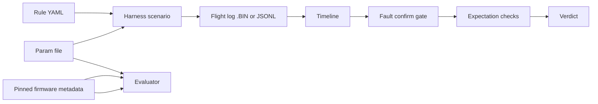

# DeadStick — design

DeadStick checks **operator-written rules** against **recorded** autopilot behavior. Rules are YAML. Parameters are `.param` files. Firmware semantics come from **metadata** extracted from the pinned ArduPilot source (see `ardupilot.lock` and `metadata/README.md`). The **flight log** is the evidence of record.

## What a rule contains

A rule YAML is a small contract. The important fields:

- **`id`**: stable name (for reports and CI).
- **`say`**: one human sentence: what you are checking.
- **`kind`**: `requirement` or `conformance` (see below).
- **`requires_params`**: parameter names that must be present in the `.param` file. If any are missing, the verdict is **CANNOT_JUDGE** with a clear reason.
- **`precondition`** (optional): a boolean expression over parameters. If it does not hold, the rule does not apply — **CANNOT_JUDGE** with `reason_if_not`.
- **`scenario`**: ordered steps the **harness** runs in SITL (inject fault, observe, etc.). Offline evaluation (`deadstick run`) does not execute the scenario; it reads whatever timeline you pass in.
- **`confirm_fault`** (optional): evidence the fault really happened on the vehicle (for example a STATUSTEXT pattern within a time window after inject). If this gate fails, expectation checks do not run.
- **`expect`**: checks bound to the timeline (mode, altitude, arm refusal, text, etc.).

## Verdicts

| Verdict | Meaning |
|--------|---------|
| **PASS** | Every executed check passed under the stated log and parameters. |
| **FAIL** | A check found forbidden or missing behavior after the fault was confirmed (when confirmation is required). |
| **CANNOT_JUDGE** | Missing data, precondition not met, ambiguous metadata label, unknown mode number, fault time unknown, or fault not confirmed when confirmation is required. Not a pass and not a fail on the behavior claim. |
| **ERROR** | Broken input, missing harness output, or evaluator bug — not a verdict on the autopilot behavior. |

The worst row in a result set is what operators care about; harness errors surface as **ERROR** with a `Harness error:` prefix when they come from SITL tooling.

## Requirement vs conformance

- **`requirement`**: the rule asserts the vehicle **must** behave in a certain way after a fault (for example enter RTL within a bound). A failed check yields **FAIL**.
- **`conformance`**: the rule checks consistency with documented semantics (for example arming blocked when disallowed). A failed check yields **FAIL** when the evidence contradicts the expected gate; otherwise outcomes follow the same verdict table.

## Fault confirmation

If **`confirm_fault`** is present, the evaluator first looks for a **fault inject time** (`fault_injected` in JSONL, or synthetic inject times from `PARM` rows in a `.BIN` timeline). It then requires at least one confirmation branch (for example STATUSTEXT match) within **`within_s` seconds** after that time.

If the fault time is unknown or confirmation fails, the result is **CANNOT_JUDGE** — expectation checks are skipped so you never **FAIL** a rule when you cannot show the fault actually happened.

## Why the flight log decides

Live MAVLink is for **recording** only. The verdict for `deadstick run` comes from the **timeline** built from the log you pass:

- **`.BIN` (dataflash)** is preferred when present: it is the vehicle’s own record.
- **`.jsonl`** is supported for development and lightweight checks.

If the log does not contain the events a check needs, you get **CANNOT_JUDGE** or **ERROR** (missing file), not a silent **PASS**.

## Metadata and parameters

Numeric `.param` values are authoritative for *what was set*. String meanings (RTL vs Land vs SmartRTL, bitmask labels, etc.) come from the **metadata JSON** keyed to the same ArduCopter tag as `ardupilot.lock`. If a label cannot be mapped safely, the evaluator returns **CANNOT_JUDGE** — it does not guess.

## Time base

Event times in timelines use **milliseconds since boot**, derived from ArduPilot **TimeUS** in `.BIN` data (`TimeUS / 1000`). Wall clock is not used for rule windows.

## Known limits (today)

- **Simulation only** in the shipped harness path; rules are validated against SITL-generated logs.
- **ArduCopter only** in the starter rules under `rules/copter/`.
- **Three starter rules** ship as examples; the engine is structured to add more.

## Architecture (overview)

This diagram is a guide for readers; filenames and commands live in the README.
